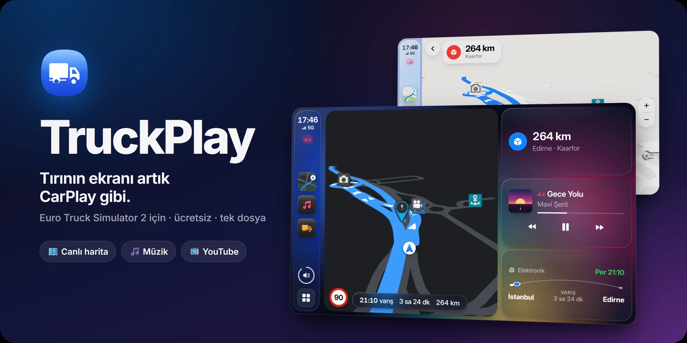
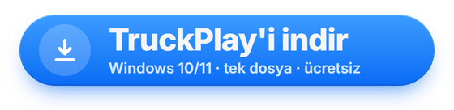
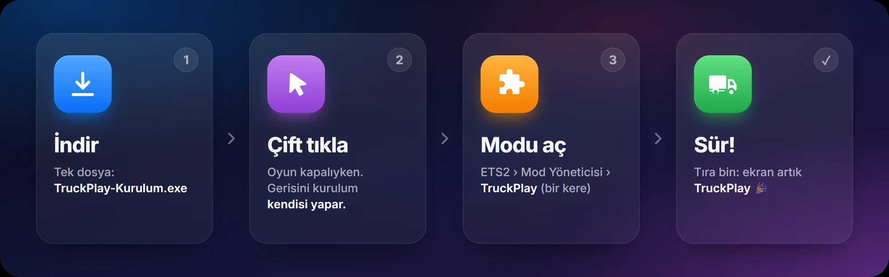
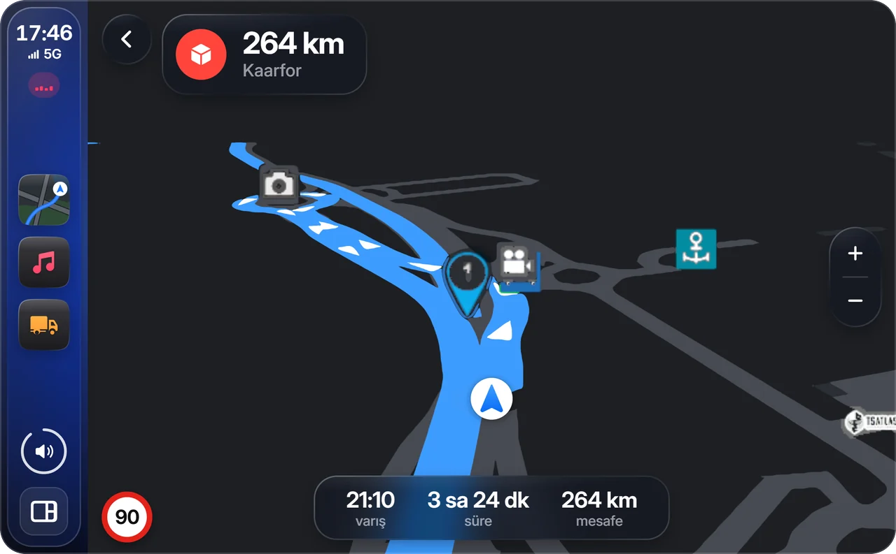
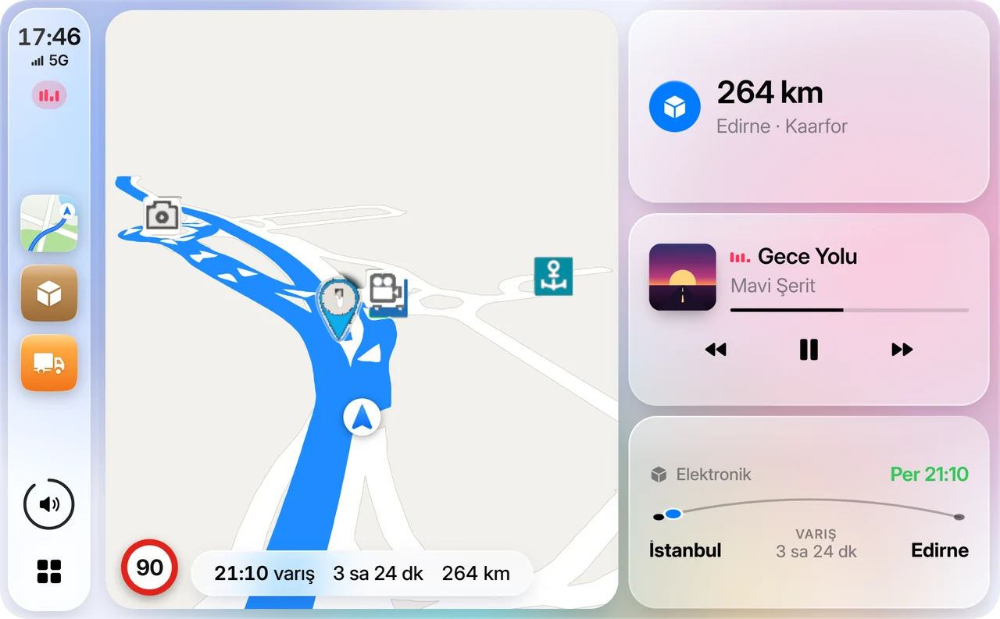
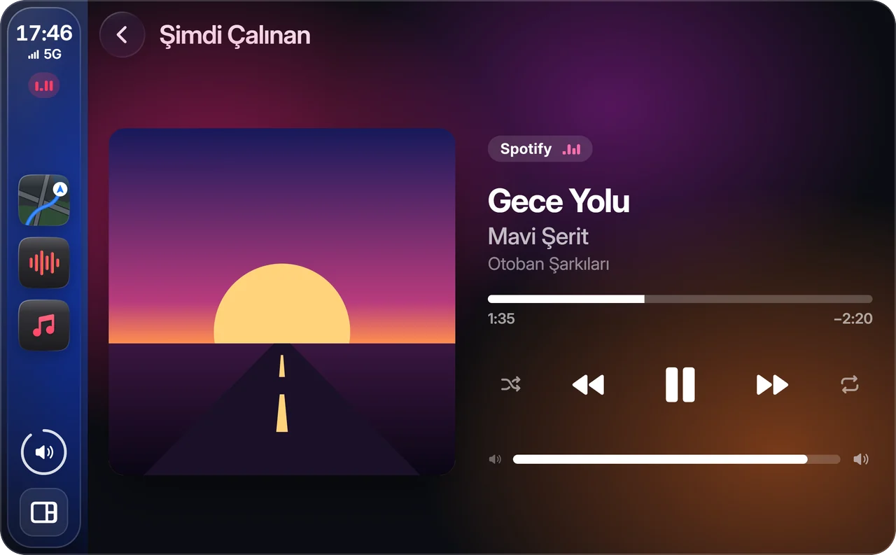
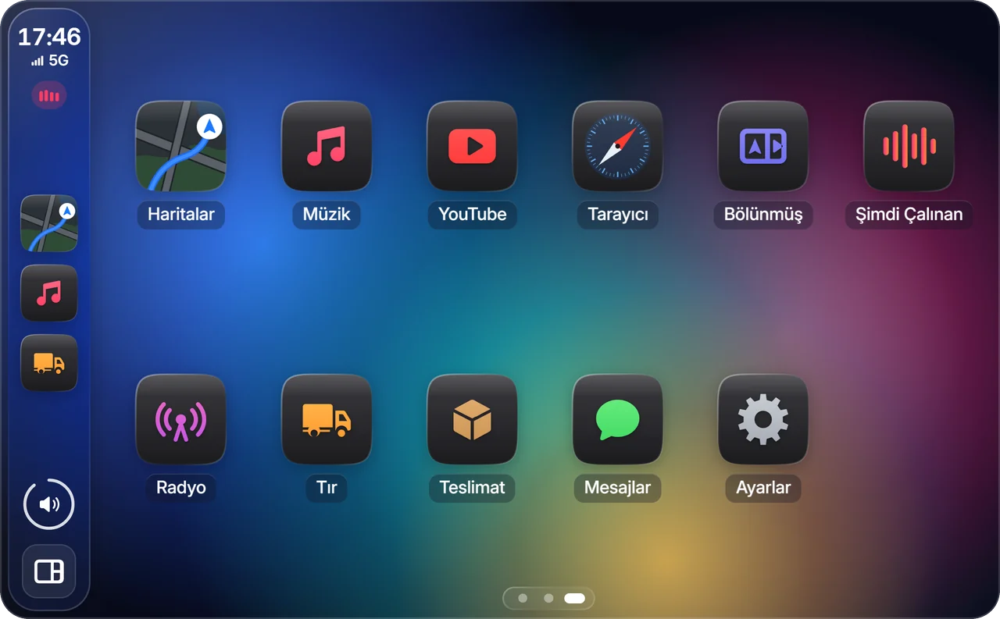
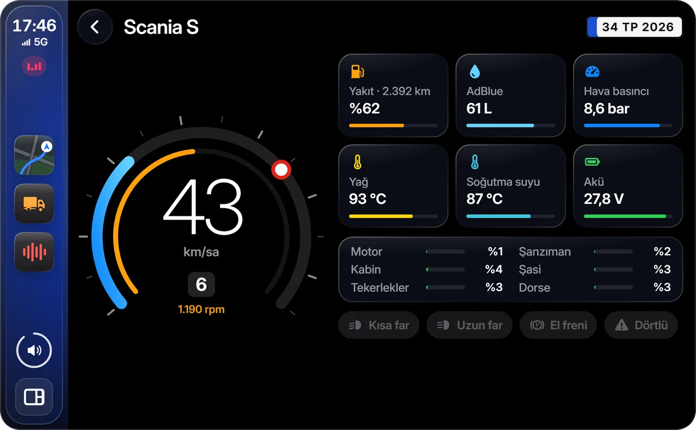
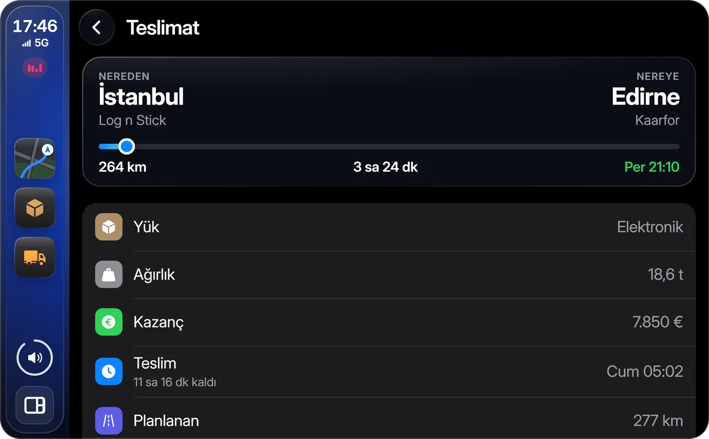
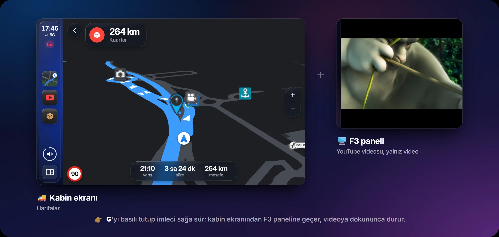

  

  

  
  
  
  

**TruckPlay**, Euro Truck Simulator 2'de tırının multimedya ekranını Apple CarPlay tarzı bir ekrana
çevirir: oyunun kendi haritası Apple Haritalar renklerinde, müzik, YouTube ve tırının bütün
bilgileri, hepsi kabindeki ekranda. 🚚✨

## ⬇️ Kurulum: 3 adım

1. 📥 **[TruckPlay-Kurulum.exe](https://github.com/unsalable/TruckPlay/releases/latest/download/TruckPlay-Kurulum.exe)**'yi
   indir. Tek dosya: başka hiçbir program kurman gerekmez.
2. 🖱️ Oyun kapalıyken dosyaya **çift tıkla**. Windows *"bilgisayarınızı korudu"* derse
   **Ek bilgi → Yine de çalıştır**. Gerisini kurulum kendisi yapar.
3. 🧩 ETS2'yi aç, eklenti uyarısına **Tamam** de. **Mod Yöneticisi**'nden **TruckPlay**'i etkinleştir
   (bir kere yeter).

🎉 Tıra bin, ekran artık TruckPlay! TruckPlay oyunla birlikte kendiliğinden açılır.

## ✨ Neler var?

<table>
  <tr>
    <td width="50%" valign="top">
       
      <b>🗺️ Canlı harita</b> 
      Oyunun kendi GPS'i, Apple Haritalar renklerinde. Rota ve işaretlerin anında, 3D binalarla.
    </td>
    <td width="50%" valign="top">
       
      <b>🏠 Gösterge paneli</b> 
      Harita, sıradaki hedef, çalan şarkı ve teslimat tek bakışta. Açık ve koyu tema.
    </td>
  </tr>
  <tr>
    <td valign="top">
       
      <b>🎵 Müzik</b> 
      Spotify, YouTube Music, radyo ve kendi şarkıların; şarkı sözleriyle.
    </td>
    <td valign="top">
       
      <b>📱 Uygulamalar</b> 
      YouTube, tarayıcı, mesajlar, ayarlar… CarPlay'deki gibi bir ana ekran.
    </td>
  </tr>
  <tr>
    <td valign="top">
       
      <b>🚛 Tır</b> 
      Hız, devir, yakıt, AdBlue, sıcaklıklar ve hasarlar.
    </td>
    <td valign="top">
       
      <b>📦 Teslimat</b> 
      Yük, kazanç, kalan yol ve teslim saati.
    </td>
  </tr>
</table>

### 🪟 Bölünmüş ekran

Kabin ekranında harita, F3 panelinde video. İki ekran tek ekran gibidir: imleç sağ kenardan panele
geçer.

## 🎮 Kısayollar

| Tuş | Ne yapar |
| --- | --- |
| **G** (basılı tut) | 🖱️ Fare ekranda imleç olur: tıkla, tekerlekle kaydır |
| **Y** | 🔍 Ekranı büyüt (video izlemek, yazı yazmak için) |
| **F3** | 🖥️ Sağ alttaki panelde de TruckPlay (Ayarlar'dan açılır) |
| **Esc** | ⏸️ Oyun durunca müzik ve video da durur, dönünce devam eder |

Tuşları Ayarlar › Ekran ve Tuşlar'dan değiştirebilirsin.

## ❓ Sık sorulanlar

🛡️ Windows "bilgisayarınızı korudu" diyor

 
Kurulum dosyası imzasız olduğu için Windows böyle der. <b>Ek bilgi → Yine de çalıştır</b>'a bas.

👀 Tırın ekranında TruckPlay görünmüyor

 
Profil ekranında <b>Mod Yöneticisi</b>'nde TruckPlay açık olmalı ve oyunu açarken çıkan eklenti
uyarısına <b>Tamam</b> demelisin. Oyun güncellendikten sonra Mod Yöneticisi'nde TruckPlay kapalı
görünürse yeniden aç; modu yeni sürüme göre TruckPlay kendisi yeniler.

🔄 Nasıl güncellerim, nasıl kaldırırım?

 
Güncellemek için yeni sürümü indirip aynı şekilde çalıştır. Kaldırmak için: Windows Ayarlar →
Uygulamalar → <b>TruckPlay</b> → Kaldır.

🌐 İnternet gerekiyor mu?

 
Oyunun haritası ve tır bilgileri internetsiz çalışır. YouTube, radyo ve şarkı sözleri için internet
gerekir. Kurulum bir kere harita verisi indirir (~115 MB, oyunsuz deneme penceresi için).

💥 Oyun açılırken ya da kariyere girerken kapanıyor

 
Çoğu zaman oyun güncellendikten sonra eski kalan başka bir eklentidir. Hangisi olduğu
<code>Belgeler\Euro Truck Simulator 2\game.crash.txt</code> içinde, <b>Fault address</b> satırının
sonunda yazar. Ayrıntılar: <a href="docs/DETAYLAR.md#oyun-açılırken-ya-da-kariyere-girerken-kapanıyorsa">oyun kapanıyorsa</a>.

## 🛠️ Geliştiriciler için

Nasıl çalıştığı, bütün uygulamalar, derleme ve test kabini: **[docs/DETAYLAR.md](docs/DETAYLAR.md)**

---

TruckPlay bağımsız bir hayran projesidir; SCS Software ya da Apple ile ilişkili değildir. Apple ve
CarPlay, Apple Inc.'in markalarıdır; TruckPlay'in ikonları ve tasarımı özgündür. Bölünmüş ekran
görselindeki video: Big Buck Bunny © Blender Foundation, CC BY 3.0. Lisanslar ve teşekkürler:
<a href="docs/DETAYLAR.md#teşekkür-ve-lisanslar">docs/DETAYLAR.md</a>.
